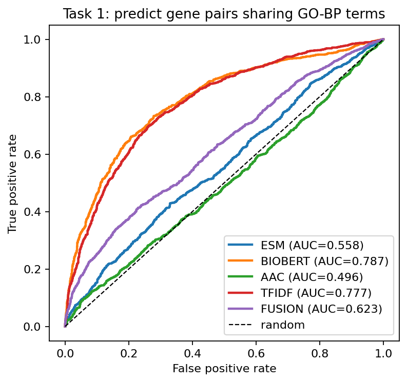
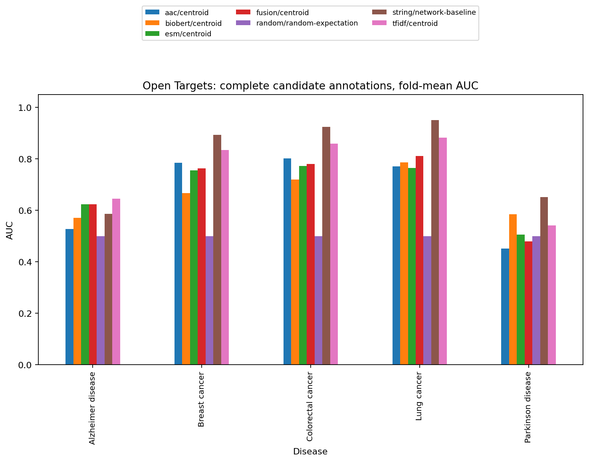
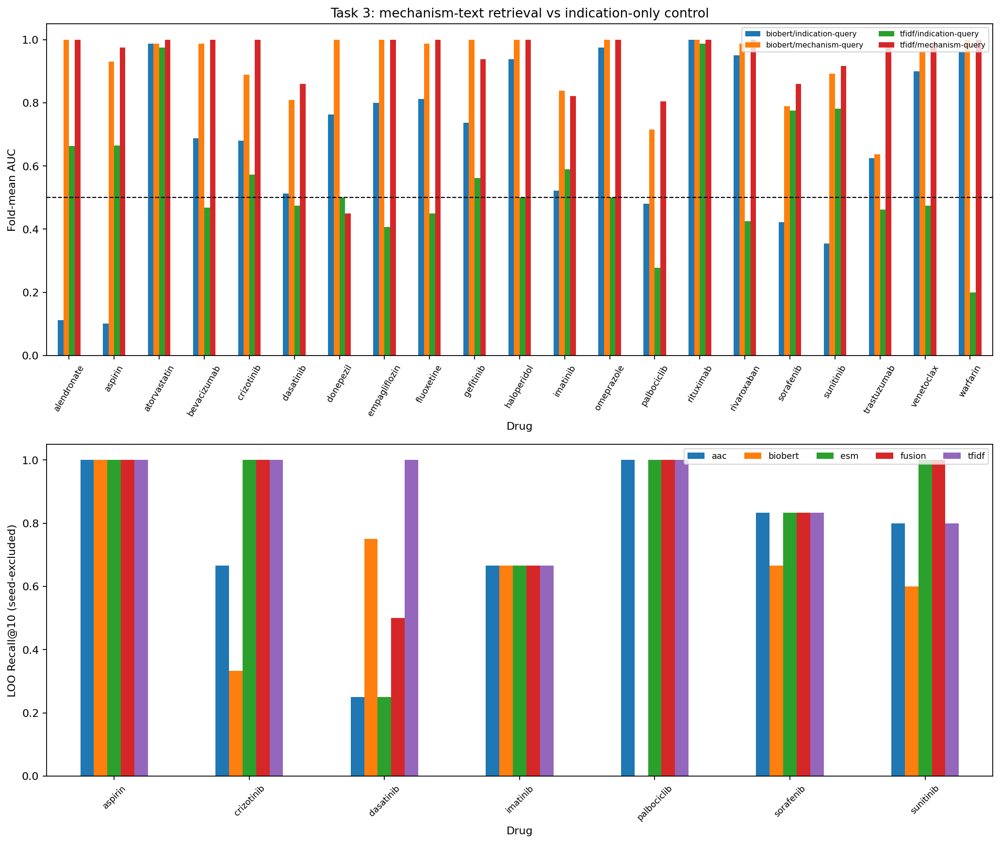
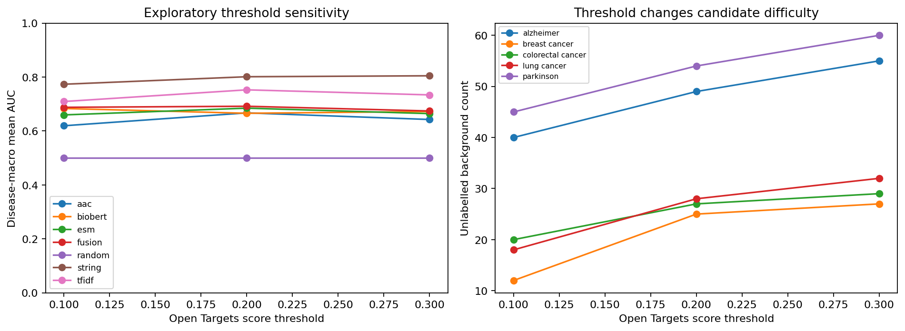

# 实验报告：预训练嵌入在什么情况下有助于基因与疾病分析？

作者：文霖川　修订日期：2026-11-03

## 1 Problem：问题与研究范围

本项目使用冻结的 ESM-2 与 BioBERT，不训练或微调大模型。主问题是：**已有预训练表示能否帮助疾病相关基因排序？这种能力与简单统计表示、文本检索、功能关联网络相比有什么边界？**

按课程要求串联 Problem → Data → Model → Benchmark → Biological interpretation。疾病相关基因排序为主线，GO 功能相似性和药物关联靶点补全为补充验证。实验范围固定为 81 个经人工选择的人类基因，不将结果外推为全基因组筛查或临床诊断能力。

需要区分两个任务：质心法**利用已知关联种子补全其他关联**；文本法根据机制描述检索已有注释。冻结模型不等于零样本疾病/药物发现，使用已知种子的部分不称为零样本预测。

## 2 Data：输入、标签和覆盖范围

### 2.1 输入与人工演示标签

基因分为9个展示类别；UniProt 缓存包含81条序列和GO-BP注释，80个基因有功能文本，其余回退到蛋白名称。原始抓取日期沿用旧文档的2026-10-25，缓存本身没有嵌入时间戳，因此该日期不视为本次重新核实的来源元数据。确切文件哈希见 `results/input_provenance.json`。

人工疾病标签包含5种疾病的已知致病、易感或相关基因；人工药物标签包含21个药物、39条药物—靶点关联。它们是历史人工整理的**演示标签**，没有逐条附原始文献，不能当作完整、独立的临床金标准。非正例统一称为未标注背景，可能仍包含尚未收录的真实关联。

### 2.2 Open Targets 与 STRING 公开注释对照

本次先把81个项目基因全部解析为 Ensembl ID，再用 GraphQL `associatedTargets(Bs:候选ID集合)` 定向获取整个候选池的分数；核对返回行数与过滤后的平台count，并拒绝旧top400缓存。GBA 项目键显式映射至当前批准符号 GBA1。**“完整”指固定候选池的查询覆盖完整，不指证明所有背景基因没有关联。**

| 疾病 | 全平台关联数 | 候选池已解析数 | 池内有记录数 | 抓取日期 |
| --- | --- | --- | --- | --- |
| 乳腺癌 | 17252 | 81 | 81 | 2026-11-03 |
| 结直肠癌 | 16268 | 81 | 81 | 2026-11-03 |
| 肺癌 | 13555 | 81 | 80 | 2026-11-03 |
| 帕金森病 | 8994 | 81 | 77 | 2026-11-03 |
| 阿尔茨海默病 | 13006 | 81 | 80 | 2026-11-03 |

主阈值为 Open Targets overall association score ≥0.2，另外报告0.1/0.3的敏感性分析。分数反映汇总关联证据，并非致病概率或置信度。标签核对表见 `results/public_disease_labels.csv`，平台版本、查询日期和范围见 `data/benchmark/manifest.json`。[Open Targets 官方评分说明](https://www.ebi.ac.uk/training/online/courses/open-targets-quick-tour/open-targets-platform/explore-target-disease-associations/)

药物公开标签取自 Open Targets mechanismsOfAction，经ChEMBL匹配药物ID；保留机制文本、actionType、targetName和复合物映射标记。机制记录映射到复合物多个组分时，各组分作为关联对象，**不等同于确认药物直接结合每个组分**。原始记录在 `data/benchmark/opentargets_drug_targets.json`。STRING 提供1074条池内功能关联边；combined score 包含多类证据，不全是物理结合。公开来源提高可追溯性，但输入和标签可能共享UniProt、文献等证据，不称为独立外部验证。

## 3 Model：表示、对照与输入处理

| 表示 | 输入与处理 | 是否训练 |
| --- | --- | --- |
| ESM-2 t6 8M，320维 | 蛋白按≤1022残基无重叠分段；排除特殊token和padding，按残基数加权平均，再L2归一化 | 否 |
| BioBERT v1.1，768维 | 清理功能文本中的证据标签和PubMed编号；按≤254个内容WordPiece分段，排除特殊token，按token数加权平均后归一化 | 否 |
| AAC，20维 | 全长序列的20种氨基酸组成频率 | 否 |
| TF-IDF | 同一批清理后的完整功能文本；词表和IDF只拟合候选基因文本，查询不更新IDF | 否 |
| fusion | L2归一化ESM/BioBERT向量等权拼接，再按相同质心流程评估；权重不按标签调优 | 否 |
| STRING | 每折对候选与该折种子之间的combined score求和 | 否 |

旧实现截去22条长蛋白的尾部；新实现覆盖所有残基。清理后的文本中有55条超过一个256-token窗口，新实现同样分段而不截断。两种模型的分段都无法恢复跨窗口注意力。完整覆盖表、输入签名及权重SHA-256分别见 `results/input_coverage.csv` 和 `data/emb/v2/summary.json`；文件夹名v2表示修订版缓存位置，内部schema记录实际处理版本。

BioBERT是预训练语言模型，直接池化是一项需要评估的设计选择，不能预设它一定是最佳句子检索表示。[Sentence-BERT 原论文](https://aclanthology.org/D19-1410/)

## 4 Benchmark：统一协议与指标

### 4.1 疾病与药物关联补全

设已知正例集合P。每次留出g∈P，**只用P去掉g后的基因作为种子**；候选集合为g加全部未标注背景。种子从候选中移除，同一折的所有候选由同一个质心或网络查询评分。每种方法使用相同的折和候选集合，文本查询虽不使用种子，其比较时也采用相同候选集合。多靶点药物才评估质心法；单靶点药物只进行文本查询和随机期望对照。

每折计算AUC、AP、Recall@10、MRR和名次；先对同一疾病/药物的折取平均，再对疾病/药物取宏平均。**禁止将不同折的分数拼接成一个AUC。**逐折种子、候选和得分保存在 `results/task2*_detail.json` 与 `task3*_detail.json`。

AUC对同分正例/背景对计0.5；ROC与AP按整个同分组跨阈值计算；Recall@10对跨越第10名的同分组给予均匀随机打破并列后的期望命中概率；名次使用中秩，MRR使用并列位置倒数的期望。每折只有一个待测正例，此时Recall@10也就是该折的hit@10。AP采用阈值分组定义，并不等于所有同分情况下的期望倒数名次。

随机基线使用精确期望：AUC=0.5，Recall@10=min(10/N,1)，期望名次=(N+1)/2，期望MRR=H_N/N。N为该折候选数，不再统一假设为81。未标注背景使这些数值成为“已知关联对背景”的区分指标，而非真实阴性上的诊断性能。

### 4.2 GO功能相似性与显著性

双方均有GO-BP注释时，按GO ID集合计算Jaccard；共享至少一条直接GO-BP为正类，报告Spearman、AUC和P@10。GO直接集合不考虑本体祖先、证据等级和术语信息量，结果反映注释重构而非完整功能等价。

进行999次**基因级置换**，同时置换相似度矩阵两轴，保留共享基因造成的基因对依赖；单侧检验统计量为AUC，p=(1+不少于观察值的置换次数)/1000。对5种表示的检验做BH校正。不把3240个基因对当作独立样本。该检验仅检验每种表示相对置换空模型，未检验模型之间的差异。其他任务只报告描述性比较；种子重叠的留一折不作为独立样本构造虚假的窄置信区间。

### 4.3 文本答案提示对照

原机制查询保留已知靶点名、别名或直接机制表达，只用于“机制文本能否检索已有功能注释”。新增indication-only条件，去掉药物名称、靶点名称和直接靶点类别描述，仅保留适应证或症状，与原条件成对比较。两组完整文本见 `results/query_definitions.csv`。这些查询是在审阅后人工指定的探索性对照，适应证仍含生物医学知识，不能解释成盲测的新靶点发现。

## 5 Results：实际结果

### 5.1 GO功能相似性

| model | spearman_cosine_vs_go_jaccard | roc_auc_shared_go | precision_at_10 | random_precision_at_10 | permutation_p_auc | permutation_q_auc_bh |
| --- | --- | --- | --- | --- | --- | --- |
| esm | 0.127 | 0.558 | 0.556 | 0.439 | 0.056 | 0.070 |
| biobert | 0.511 | 0.787 | 0.714 | 0.439 | 0.001 | 0.002 |
| aac | 0.029 | 0.496 | 0.496 | 0.439 | 0.544 | 0.544 |
| tfidf | 0.496 | 0.777 | 0.706 | 0.439 | 0.001 | 0.002 |
| fusion | 0.238 | 0.623 | 0.623 | 0.439 | 0.001 | 0.002 |

ESM-2的AUC为0.558，BH校正q=0.070，**在0.05门槛下没有显著证据拒绝置换空模型**。BioBERT的AUC为0.787，与TF-IDF相比只呈现数值差异，本实验未检验该差异是否显著。功能文本和GO来自同一注释体系，不能把较高分数解释成独立生物学发现。



### 5.2 主任务：疾病相关基因排序

人工演示标签，各方法均使用修正后的逐折协议：

| 疾病 | 正例数 | 背景数 | 每折候选数 | esm | biobert | aac | tfidf | fusion | random_Recall@10 |
| --- | --- | --- | --- | --- | --- | --- | --- | --- | --- |
| 乳腺癌 | 8 | 73 | 74 | 0.675 | 0.892 | 0.675 | 0.943 | 0.759 | 0.135 |
| 结直肠癌 | 6 | 75 | 76 | 0.658 | 0.500 | 0.540 | 0.658 | 0.629 | 0.132 |
| 肺癌 | 7 | 74 | 75 | 0.805 | 0.786 | 0.693 | 0.703 | 0.803 | 0.133 |
| 帕金森病 | 6 | 75 | 76 | 0.427 | 0.751 | 0.371 | 0.758 | 0.440 | 0.132 |
| 阿尔茨海默病 | 6 | 75 | 76 | 0.618 | 0.807 | 0.318 | 0.922 | 0.656 | 0.132 |

公开注释对照，阈值0.2：

| 疾病 | 正例数 | 背景数 | 每折候选数 | esm | biobert | aac | tfidf | fusion | string | random_Recall@10 |
| --- | --- | --- | --- | --- | --- | --- | --- | --- | --- | --- |
| 乳腺癌 | 56 | 25 | 26 | 0.755 | 0.666 | 0.784 | 0.834 | 0.763 | 0.892 | 0.385 |
| 结直肠癌 | 54 | 27 | 28 | 0.772 | 0.719 | 0.801 | 0.859 | 0.781 | 0.925 | 0.357 |
| 肺癌 | 53 | 28 | 29 | 0.765 | 0.786 | 0.771 | 0.883 | 0.811 | 0.950 | 0.345 |
| 帕金森病 | 27 | 54 | 55 | 0.506 | 0.584 | 0.452 | 0.542 | 0.480 | 0.651 | 0.182 |
| 阿尔茨海默病 | 32 | 49 | 50 | 0.624 | 0.571 | 0.527 | 0.645 | 0.624 | 0.587 | 0.200 |

各疾病等权宏平均：

| 表示/基线 | 方法 | 平均AUC | 平均Recall@10 | 平均MRR |
| --- | --- | --- | --- | --- |
| aac | centroid | 0.667 | 0.504 | 0.296 |
| biobert | centroid | 0.665 | 0.552 | 0.210 |
| esm | centroid | 0.685 | 0.595 | 0.264 |
| fusion | centroid | 0.692 | 0.615 | 0.252 |
| random | random-expectation | 0.500 | 0.294 | 0.120 |
| string | network-baseline | 0.801 | 0.689 | 0.489 |
| tfidf | centroid | 0.752 | 0.598 | 0.423 |

ESM-2公开疾病AUC宏平均为0.685，AAC为0.667，TF-IDF为0.752，STRING为0.801。这些观察说明简单文本统计和网络先验具有竞争力，不能宣称预训练表示总体优于基线。正例数量随阈值改变，各疾病每折候选数和随机Recall@10已并列给出，避免把较小背景池上的命中率当成全基因组表现。



### 5.3 药物补充任务

下表为公开机制标签中可留一评估的ESM-2药物结果：

| drug | n_targets | auc | hit_at_10 | mrr |
| --- | --- | --- | --- | --- |
| imatinib | 2 | 0.563 | 0.000 | 0.033 |
| aspirin | 2 | 1.000 | 1.000 | 1.000 |
| haloperidol | 2 | 0.987 | 1.000 | 0.500 |
| sorafenib | 6 | 0.936 | 0.833 | 0.218 |
| crizotinib | 3 | 0.974 | 1.000 | 0.511 |
| palbociclib | 3 | 0.667 | 0.333 | 0.066 |
| sunitinib | 5 | 0.989 | 1.000 | 0.840 |

在同一批可留一药物上，ESM-2质心AUC宏平均为0.874，TF-IDF质心为0.935。单靶点药物不计入质心宏平均。部分药物效果好并不证明未知靶点发现，更不能把单个药物的一两个正例推广为稳定性能。

公开药物文本条件对照，先对每个药物的折平均，再对21个药物等权平均：

| model | method | auc | hit_at_10 | mrr |
| --- | --- | --- | --- | --- |
| biobert | indication-query | 0.683 | 0.351 | 0.147 |
| biobert | mechanism-query | 0.931 | 0.841 | 0.536 |
| tfidf | indication-query | 0.551 | 0.202 | 0.091 |
| tfidf | mechanism-query | 0.928 | 0.809 | 0.616 |

原机制查询比仅适应证查询表现更高，提示已知靶点/机制信息能明显影响结果；同时两组的语义信息量也不同，因此不能把全部差异精确归因于某个靶点名字。TF-IDF在机制查询中同样表现较好，进一步说明需要区分文本匹配与新的药物机制推断。



### 5.4 阈值与融合的边界

下表是0.1/0.2/0.3阈值下的疾病宏平均AUC；阈值0.2为主分析，其他条件用于展示敏感性，未按最高分挑阈值：

| threshold | aac | biobert | esm | fusion | string | tfidf |
| --- | --- | --- | --- | --- | --- | --- |
| 0.100 | 0.619 | 0.683 | 0.659 | 0.688 | 0.773 | 0.709 |
| 0.200 | 0.667 | 0.665 | 0.685 | 0.692 | 0.801 | 0.752 |
| 0.300 | 0.642 | 0.672 | 0.664 | 0.674 | 0.805 | 0.734 |

固定等权融合的公开疾病AUC为0.692，单独ESM-2为0.685，BioBERT为0.665。结合其他任务，融合没有稳定超过各任务最佳单一表示，**不支持“两个空间不相关，所以融合必然更好”**的推断。



## 6 Biological interpretation：解释、验证与局限

在公开阿尔茨海默病标签中，移除 APP 后，仅用其余正例作为种子，APP 在 50 个候选中排第 11.0，这才是可用于讨论关联补全的案例；种子及完整得分见逐折 JSON。

APP是淀粉样前体蛋白，PSEN1/PSEN2属于presenilin相关蛋白；它们参与相关加工过程，不应统称“APP/PSEN家族”。共同参与通路也不能直接证明序列相似或解释ESM的排序原因。序列、结构域、蛋白长度/组成和文本重叠都可能影响结果，需额外分析才能归因。[UniProt APP](https://www.uniprot.org/uniprotkb/P05067/entry/)、[γ-secretase复合物注释](https://www.uniprot.org/uniprotkb/Q9NZ42/entry)

部分激酶药物的序列补全结果较高，与共享结构域的假设相容，但本实验未进行家族隔离或结构域消融，不能确认模型学到了超出同源性和组成的药理选择性。疾病关联跨多类蛋白时，单一均值可能丢失不同机制，但失败原因也应视为待验证假设。

主要局限：候选基因经人工选择，包含较多癌症通路及已知药物靶点，存在选择偏差；没有家族隔离、时间切分或真正新疾病/新药物外部集；预训练语料与公开注释的重叠未知；Open Targets阈值标签与人工标签定义不同；GBA等缺少功能文本的基因影响文本表示；分段编码没有跨窗口上下文；样本数小、关联不完备且部分机制记录指向复合物。更大模型不一定更好，本实验未做模型规模比较。

可验证的下一步是：扩大并预先固定候选池；按蛋白家族或时间划分测试；为优先候选补充独立文献证据或实验验证；加入序列比对与结构域匹配对照。PCA和热图只展示空间结构，不单独作为机制证据或预测成功的依据。

## 7 修订影响、复现与交付

以下只针对人工疾病质心法：先固定旧嵌入，仅修评估，再换成修正的完整输入。这样可以区分协议修正与输入变化，不能将全部变化归因于某一处理步骤。

| 模型 | 原报告算法AUC | 旧嵌入+修正协议AUC | 修正输入+协议AUC |
| --- | --- | --- | --- |
| biobert | 0.682 | 0.533 | 0.747 |
| esm | 0.751 | 0.637 | 0.636 |

运行环境：Python 3.10.21，包版本见 `results/environment.json`。本机Torch为开发版本，移植环境允许兼容稳定版，重新推理可能存在小数值差异；随附嵌入缓存用于精确重算下游指标。所有模型仅前向推理，参数关闭梯度。

```text
python main.py --steps all --offline
python -m unittest discover -s tests -v
```

首次配置和模型下载见README。离线模式缺少完整公开缓存时明确失败，不把旧top400当作完整标签。`--steps report`只从已完成结果生成文档。结果CSV、逐折JSON、输入与查询审计、8张图和源代码均可审阅；旧版保存在 `archive_before_revision_20261103/`，不与新版结果混用。

**GitHub交付状态：当前目录没有已配置的远程仓库，未发布，也没有真实仓库URL。** 代码、忽略规则和可迁移运行说明已备齐；提交前需要项目成员将这些材料上传至实际课程仓库并填写真实链接。不能以示例地址冒充交付链接。十分钟汇报提纲见 `汇报提纲.md`。

## 8 结论

本实践完成了冻结生物医学预训练表示的三类小规模实验。结果支持“已有表示能用于关联补全和注释检索”，但**优势依赖任务、标签和输入条件**。网络与简单文本统计在若干条件下更强；ESM-2在部分药物关联补全中表现较好，在GO任务中未达到校正后的显著性门槛；含靶点提示的文本检索高分不能作为未知靶点发现能力。严谨的评估、强简单基线和明确的任务边界比单独报告高AUC更能支撑课程结论。

## 9 主要来源

1. Lin et al. Evolutionary-scale prediction of atomic-level protein structure with a language model. Science, 2023. [ESM-2官方仓库](https://github.com/facebookresearch/esm)
2. Lee et al. BioBERT: a pre-trained biomedical language representation model for biomedical text mining. Bioinformatics, 2020. [BioBERT官方仓库](https://github.com/dmis-lab/biobert)
3. [UniProt REST API](https://www.uniprot.org/help/api)，蛋白序列、功能文本和GO注释。
4. [Open Targets GraphQL API](https://platform-docs.opentargets.org/data-access/graphql-api)，疾病关联与药物机制。
5. [ChEMBL官方API](https://www.ebi.ac.uk/chembl/api/data/docs)，药物身份匹配。
6. [STRING官方API](https://string-db.org/help/api/)，功能关联网络。
7. Reimers & Gurevych. [Sentence-BERT](https://aclanthology.org/D19-1410/), EMNLP-IJCNLP, 2019.
